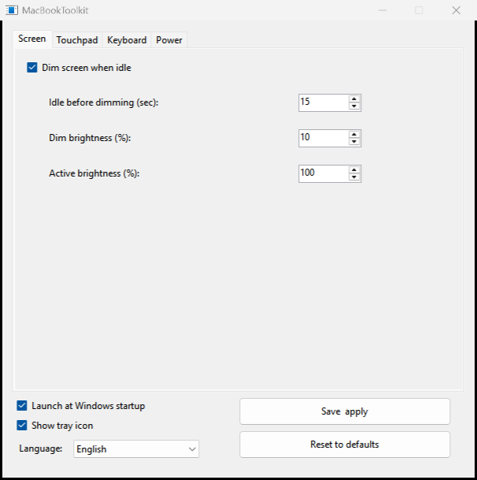
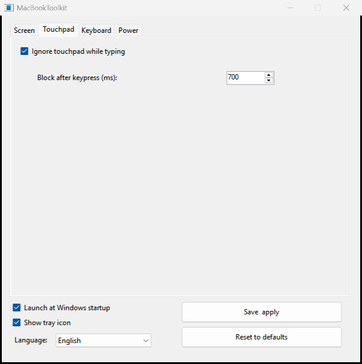
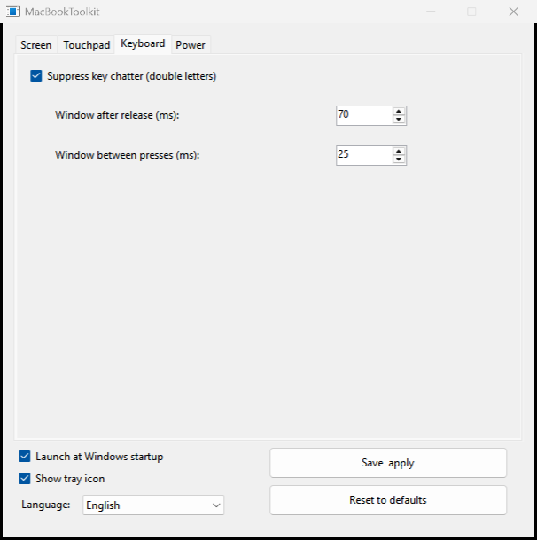
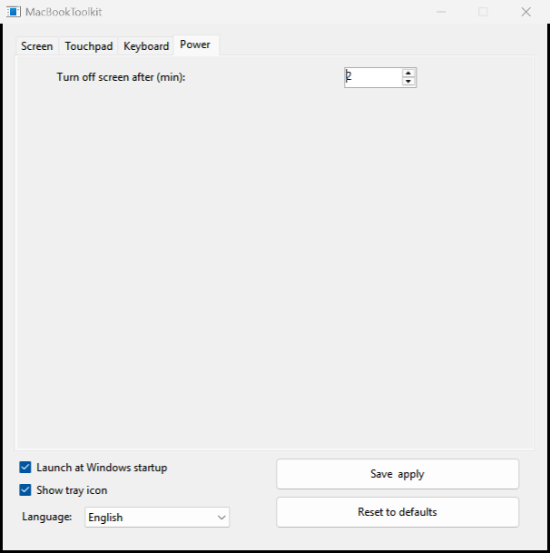
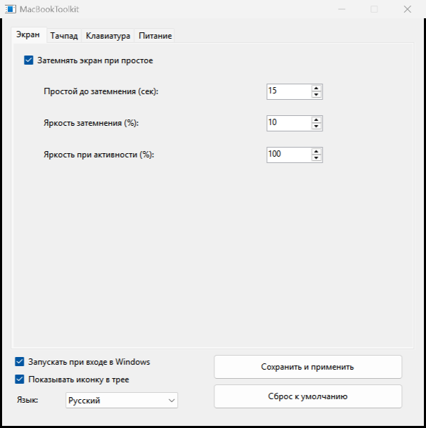
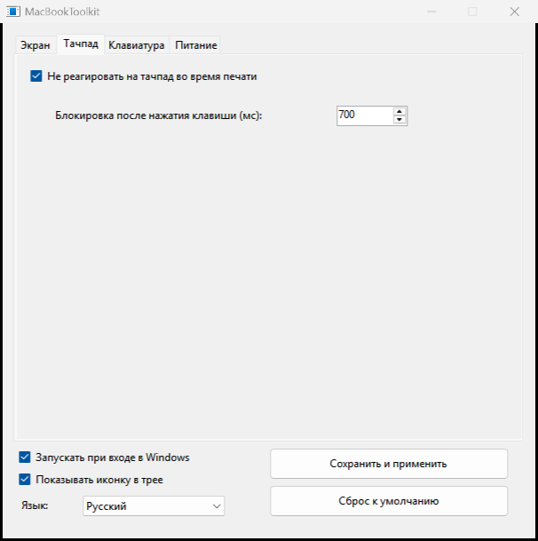
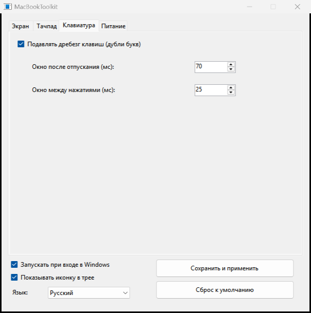
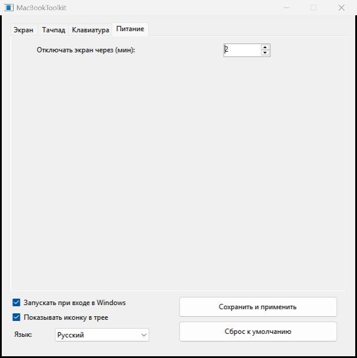

# 🖥️ MacBookToolkit

**[🇬🇧 English](#english)** · **[🇷🇺 Русский](#russian)**

> A tiny, portable **Windows laptop utility** born on a MacBook Pro (Boot Camp).
> It adds the small quality-of-life tweaks Windows lacks out of the box —
> automatic screen dimming, touchpad blocking while typing, and key-chatter
> suppression for the butterfly keyboard.

> **🎯 Built for Windows running natively on MacBook hardware.** No macOS is
> required — you can erase macOS completely and use Windows alone with the
> Boot Camp drivers. It is a Windows app, not a macOS app, and it does not need
> macOS in any way.

**📥 [Download the latest release](https://github.com/the-big-paul/MacBookToolkit/releases/latest)** · **📄 [MIT License](LICENSE)**


---

<a id="english"></a>
## 🇬🇧 English

### 📸 Screenshots

| 🔆 Screen | 🖱️ Touchpad |
|---|---|
|  |  |
| ⌨️ Keyboard | 🔋 Power |
|  |  |

### ✨ Features

#### 🔆 Screen auto-dim
**What it does:** after a configurable number of seconds without mouse or
keyboard input, the display brightness drops to a chosen level (default **10%**).
The moment you touch the keyboard or trackpad, it instantly returns to normal
(**100%**).

**Why it is useful:** a laptop screen at full brightness drains the battery and
is unpleasant at night. Instead of constantly fiddling with the brightness keys,
the display dims itself when you step away from the keyboard and snaps back the
moment you return.

#### 🖱️ Touchpad guard
**What it does:** while you type, the touchpad ignores contact for a configurable
time after each keypress (default **700 ms**).

**Why it is useful:** on a laptop your palms rest right next to the trackpad.
An accidental touch whips the cursor to a random place in the middle of a
sentence, and you keep fixing it. Windows has a built-in "palm rejection"
setting, but on many machines it is too weak. This is a hard, reliable block
that only lasts while you are actually typing.

#### ⌨️ Key debounce (butterfly-keyboard fix)
**What it does:** the butterfly keyboards in 2016–2019 MacBook Pros are infamous
for **double-typing** — one physical press registers as two characters. This
feature spots a second press of the same key arriving suspiciously fast after
the release (default **70 ms**) and silently drops it, without slowing down
normal fast typing.

**Why it is useful:** it fixes a known hardware defect in software. It is tuned
carefully to stay out of your way:
- **Backspace, Delete, arrows, Enter, Tab, Esc and modifiers are excluded**, so
  fast deletion and navigation still work;
- **auto-repeat is untouched**, so holding a key still repeats;
- **injected input is ignored**, so third-party tools such as Caramba Switcher
  keep working.

#### 🔋 Screen timeout
**What it does:** sets the Windows "turn off display after" timeout directly
from the GUI (default **2 minutes**).

**Why it is useful:** saves power and protects your privacy when you walk away,
without digging through the Control Panel.

#### 🌍 Three languages
The whole interface — tabs, labels, tooltips and the tray menu — is available in
**English, Русский and Українська**, switchable on the fly.

#### 💡 Tooltips everywhere
Hover over any setting to get a plain-language explanation of what it does and
how to pick the right value.

#### ⚙️ Tray icon + autostart
Runs quietly in the system tray (optionally hidden), starts with Windows on
demand.

#### 🔄 Reset to the tuned defaults
A single button restores the settings this project was tuned for:

| Setting | Default |
|---|---|
| 🔆 Screen dim | 15 s idle → 10 %, restore to 100 % |
| 🖱️ Touchpad block | 700 ms |
| ⌨️ Key debounce | 70 ms after release / 25 ms between presses |
| 🔋 Screen timeout | 2 min |

### 📦 Requirements
- Windows 7 / 8 / 10 / 11 (x86 or x64)
- .NET Framework 4.x (preinstalled on Windows 10/11)
- For the screen-dimming feature: a laptop whose brightness is controllable via
  WMI (most laptops; desktop PCs simply won't have this feature)

### 🧪 Tested on
- **MacBook Pro 15" (2018, A1990)** — Intel Core i7-8750H, Radeon Pro 555X
- **Windows 11 26H2**, build **26300.9818**, with Boot Camp drivers
- macOS was completely removed — Windows runs natively on the Mac hardware

### 🛠️ Build
No toolchain needed — `csc.exe` ships with the .NET Framework:

```powershell
powershell -ExecutionPolicy Bypass -File build.ps1
```

Or manually:

```bat
csc /nologo /target:winexe /win32icon:app.ico /out:MacBookToolkit.exe ^
    /reference:System.dll /reference:System.Windows.Forms.dll ^
    /reference:System.Drawing.dll /reference:System.Management.dll ^
    MacBookToolkit.cs AssemblyInfo.cs
```

The result is a single portable `MacBookToolkit.exe` (~58 KB, version 1.1). No
installer, no dependencies — copy it anywhere and run it.

Logic tests (no hardware needed):

```powershell
powershell -ExecutionPolicy Bypass -File tests\run-tests.ps1
```

### 🚀 Usage
1. Run `MacBookToolkit.exe`.
2. Configure the tabs, press **Save & apply**.
3. Close the window to send it to the tray (or turn the tray icon off).
4. Settings live in `%APPDATA%\MacBookToolkit\settings.ini`.

### 🧩 How it works (short version)
- **Low-level hooks** (`WH_KEYBOARD_LL`, `WH_MOUSE_LL`) power the touchpad guard
  and the key debounce. Injected input (`LLKHF_INJECTED`) and service keys are
  excluded, so fast deletion, auto-repeat and layout switchers keep working.
- **Screen brightness** is set through the WMI class
  `root\wmi:WmiMonitorBrightnessMethods`.
- **Idle detection** uses `GetLastInputInfo`.
- **Screen timeout** is applied with `powercfg`.

### 🆕 Changelog

**v1.1**
- Fixed: dimming flickered when the idle timeout was set to 1 s (the restore
  threshold was a hard-coded 2 s instead of the configured timeout).
- Fixed: turning the dimming off while the screen was dimmed left the display
  dark — brightness is now restored immediately.
- Fixed: a "between presses" window above ~32 ms silently disabled key
  auto-repeat; the setting is now capped at 30 ms (values above that are clamped
  on load).
- Settings are now validated and clamped on load, so a hand-edited
  `settings.ini` can no longer put the program into a broken state.
- Added a proper Windows version resource (file version **1.1.0.0**).
- Unhandled exceptions are now logged to `%APPDATA%\MacBookToolkit\errors.log`.
- Fixed a WMI handle leak in the brightness code.
- Fixed: brightness could stay dim if the app exited while dimmed — it is now
  restored on exit.
- Fixed: the touchpad guard swallowed mouse button-up and wheel events (a drag
  could get stuck, scrolling was lost); it now blocks only cursor movement and
  button-downs, and ignores synthetic input.
- Fixed: failed brightness control no longer leaves a phantom "dimmed" state.
- `settings.ini` is written atomically (temp file + replace); write errors are logged.
- Hook installation failures are detected, logged, and the affected option is disabled.
- A second launch now shows a message instead of silently doing nothing.
- First run / unreadable settings no longer silently re-enable autostart or
  rewrite the power plan.
- `powercfg` runs off the UI thread, so startup and saving no longer freeze.
- Win / Apps / PrintScreen keys are excluded from the key debounce.
- Fixed process/WMI handle and tray/timer/icon leaks.

**v1.0** — first public release.

### 📄 License
MIT — free to use, modify, merge, publish, distribute, sublicense and sell.
See [LICENSE](LICENSE).

### ⚠️ Disclaimer
Keyboard and mouse hooks affect system-wide input. The program is provided
"as is", without warranty of any kind. Use at your own risk.

---

<a id="russian"></a>
## 🇷🇺 Русский

> **🎯 Сделано для Windows, работающей напрямую на железе MacBook.** macOS не
> нужен — его можно полностью удалить и пользоваться только Windows с драйверами
> Boot Camp. Это приложение для Windows, а не для macOS, и macOS для работы ему
> не требуется.

### 📸 Скриншоты

| 🔆 Экран | 🖱️ Тачпад |
|---|---|
|  |  |
| ⌨️ Клавиатура | 🔋 Питание |
|  |  |

### ✨ Возможности

#### 🔆 Автоматическое затемнение экрана
**Что делает:** если в течение заданного времени нет ввода с мыши или
клавиатуры, яркость экрана снижается до выбранного уровня (по умолчанию
**10 %**). Как только вы касаетесь клавиатуры или тачпада — яркость мгновенно
возвращается к обычной (**100 %**).

**Зачем это нужно:** экран на полной яркости сажает батарею и слепит ночью.
Вместо того чтобы постоянно крутить клавиши яркости, экран сам притухает, когда
вы отошли от клавиатуры, и мгновенно возвращается, когда вы вернулись.

#### 🖱️ Защита тачпада
**Что делает:** пока вы печатаете, тачпад игнорирует касания в течение
заданного времени после каждого нажатия клавиши (по умолчанию **700 мс**).

**Зачем это нужно:** на ноутбуке ладони лежат прямо рядом с тачпадом. Случайное
касание уводит курсор в случайное место посреди предложения, и вы постоянно это
исправляете. В Windows есть встроенное «отсеивание ладоней», но на многих
машинах оно слишком слабое. Здесь — жёсткая и надёжная блокировка, которая
работает только пока вы действительно печатаете.

#### ⌨️ Подавление дребезга (лечение butterfly-клавиатуры)
**Что делает:** butterfly-клавиатуры MacBook Pro 2016–2019 годов печально
известны **двойными срабатываниями** — одно физическое нажатие регистрируется
как два символа. Эта функция замечает второе нажатие той же клавиши, пришедшее
подозрительно быстро после отпускания (по умолчанию **70 мс**), и тихо его
отбрасывает, не замедляя обычный быстрый набор.

**Зачем это нужно:** это лечит известный аппаратный дефект программно. Настройка
подобрана так, чтобы не мешать:
- **Backspace, Delete, стрелки, Enter, Tab, Esc и модификаторы исключены** —
  быстрое удаление и навигация работают как обычно;
- **авто-повтор не затрагивается** — удержание клавиши по-прежнему повторяет
  символ;
- **инжектированный ввод игнорируется** — сторонние утилиты вроде Caramba
  Switcher продолжают работать.

#### 🔋 Таймаут экрана
**Что делает:** задаёт встроенный в Windows таймаут «выключать экран через…»
прямо из графического интерфейса (по умолчанию **2 минуты**).

**Зачем это нужно:** экономия энергии и конфиденциальность, когда вы отошли, —
без копания в Панели управления.

#### 🌍 Три языка
Весь интерфейс — вкладки, подписи, подсказки и меню в трее — доступен на
**русском, украинском и английском**, переключается на лету.

#### 💡 Подсказки везде
Наведите курсор на любую настройку — появится простое объяснение, что она
делает и как выбрать значение.

#### ⚙️ Иконка в трее и автозапуск
Тихо живёт в системном трее (при желании скрывается), при необходимости
запускается вместе с Windows.

#### 🔄 Сброс к подобранным настройкам
Одна кнопка возвращает значения, под которые проект настраивался:

| Настройка | По умолчанию |
|---|---|
| 🔆 Затемнение экрана | простой 15 с → 10 %, активность → 100 % |
| 🖱️ Блокировка тачпада | 700 мс |
| ⌨️ Дебаунс клавиш | 70 мс после отпускания / 25 мс между нажатиями |
| 🔋 Таймаут экрана | 2 мин |

### 📦 Требования
- Windows 7 / 8 / 10 / 11 (x86 или x64)
- .NET Framework 4.x (предустановлен на Windows 10/11)
- Для затемнения экрана: ноутбук, яркостью которого можно управлять через WMI
  (большинство ноутбуков; на настольных ПК эта функция просто не понадобится)

### 🧪 Проверено на
- **MacBook Pro 15" (2018, A1990)** — Intel Core i7-8750H, Radeon Pro 555X
- **Windows 11 26H2**, сборка **26300.9818**, с драйверами Boot Camp
- macOS полностью удалён — Windows работает напрямую на железе Mac

### 🛠️ Сборка
Инструменты не нужны — `csc.exe` уже есть в составе .NET Framework:

```powershell
powershell -ExecutionPolicy Bypass -File build.ps1
```

Или вручную:

```bat
csc /nologo /target:winexe /win32icon:app.ico /out:MacBookToolkit.exe ^
    /reference:System.dll /reference:System.Windows.Forms.dll ^
    /reference:System.Drawing.dll /reference:System.Management.dll ^
    MacBookToolkit.cs AssemblyInfo.cs
```

На выходе — один портативный `MacBookToolkit.exe` (~58 КБ, версия 1.1). Без
установщика и зависимостей: скопируйте в любое место и запустите.

Логические тесты (железо не нужно):

```powershell
powershell -ExecutionPolicy Bypass -File tests\run-tests.ps1
```

### 🚀 Использование
1. Запустите `MacBookToolkit.exe`.
2. Настройте вкладки и нажмите **«Сохранить и применить»**.
3. Закройте окно — программа уйдёт в трей (или отключите иконку в трее).
4. Настройки хранятся в `%APPDATA%\MacBookToolkit\settings.ini`.

### 🧩 Как это устроено (кратко)
- **Низкоуровневые хуки** (`WH_KEYBOARD_LL`, `WH_MOUSE_LL`) отвечают за защиту
  тачпада и дебаунс клавиш. Инжектированный ввод (`LLKHF_INJECTED`) и служебные
  клавиши исключены, поэтому быстрое удаление, авто-повтор и переключатели
  раскладки продолжают работать.
- **Яркость экрана** задаётся через класс WMI
  `root\wmi:WmiMonitorBrightnessMethods`.
- **Определение простоя** — через `GetLastInputInfo`.
- **Таймаут экрана** применяется командой `powercfg`.

### 🆕 Changelog

**v1.1**
- Исправлено: затемнение мерцало, если простой до затемнения был выставлен в 1 с
  (порог возврата был жёстко 2 с вместо настроенного таймаута).
- Исправлено: при отключении затемнения в приглушённом состоянии экран оставался
  тёмным — теперь яркость сразу восстанавливается.
- Исправлено: окно «между нажатиями» больше ~32 мс незаметно отключало
  авто-повтор клавиш; ползунок ограничен 30 мс (при загрузке значения
  обрезаются).
- `settings.ini` теперь валидируется и обрезается по допустимым диапазонам, так
  что вручную исправленный файл больше не может привести программу в странное
  состояние.
- Добавлен нормальный Version-ресурс Windows (версия файла **1.1.0.0**).
- Необработанные исключения теперь пишутся в `%APPDATA%\MacBookToolkit\errors.log`.
- Исправлена утечка WMI-хэндлов в коде яркости.
- Исправлено: яркость могла остаться приглушённой, если закрыть программу в этот
  момент — теперь она восстанавливается при выходе.
- Исправлено: защита тачпада глотала button-up и колесо мыши (залипал драг,
  терялся скролл) — теперь блокируются только движение и button-down,
  синтетический ввод игнорируется.
- Исправлено: при недоступном управлении яркостью больше нет «фантомного»
  состояния «затемнено».
- `settings.ini` пишется атомарно (временный файл + замена), ошибки записи логируются.
- Неудачная установка хуков теперь обнаруживается, логируется, а соответствующая
  опция отключается.
- Второй запуск показывает сообщение, а не молчит.
- Первый запуск / нечитаемые настройки больше не включают молча автозапуск и не
  перезаписывают план питания.
- `powercfg` выполняется не в UI-потоке — запуск и сохранение больше не подвешивают окно.
- Win / Apps / PrintScreen исключены из дебаунса клавиш.
- Исправлены утечки хэндлов (процессы, WMI) и объектов трея/таймера/иконки.

**v1.0** — первый публичный релиз.

### 📄 Лицензия
MIT — можно использовать, изменять, объединять, публиковать, распространять,
сублицензировать и продавать. См. [LICENSE](LICENSE).

### ⚠️ Отказ от ответственности
Хуки клавиатуры и мыши влияют на ввод во всей системе. Программа
предоставляется «как есть», без каких-либо гарантий. Используйте на свой риск.
