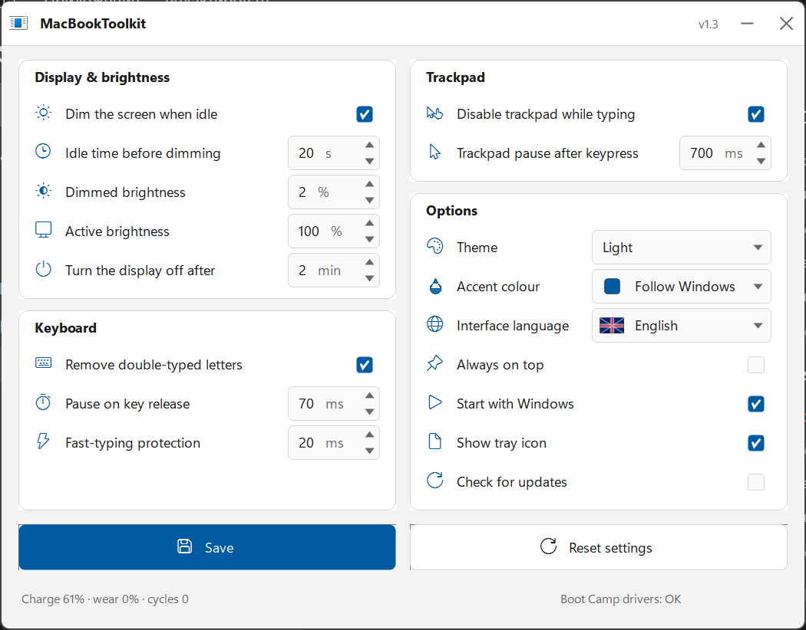
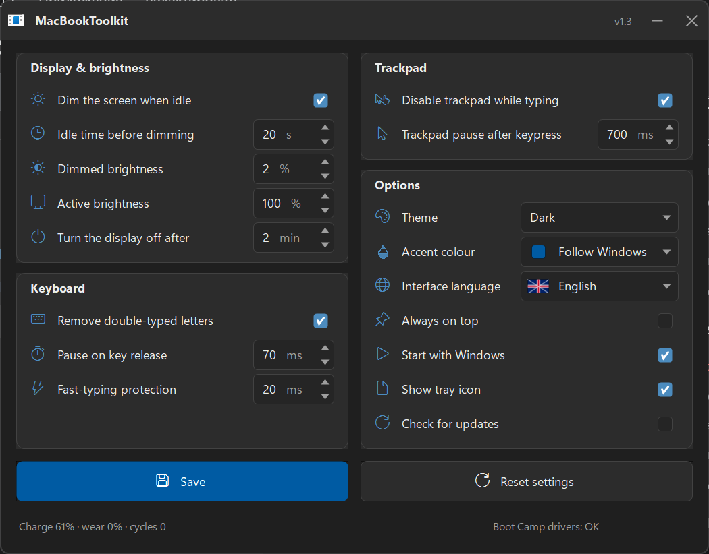
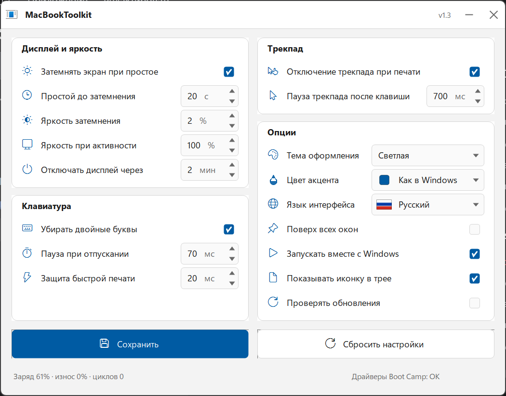
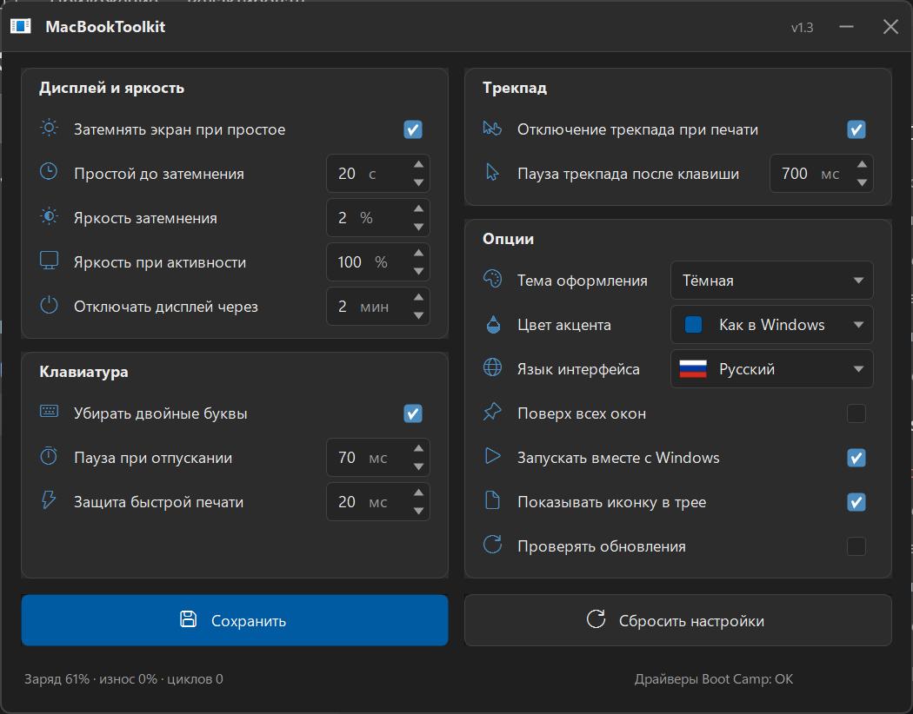
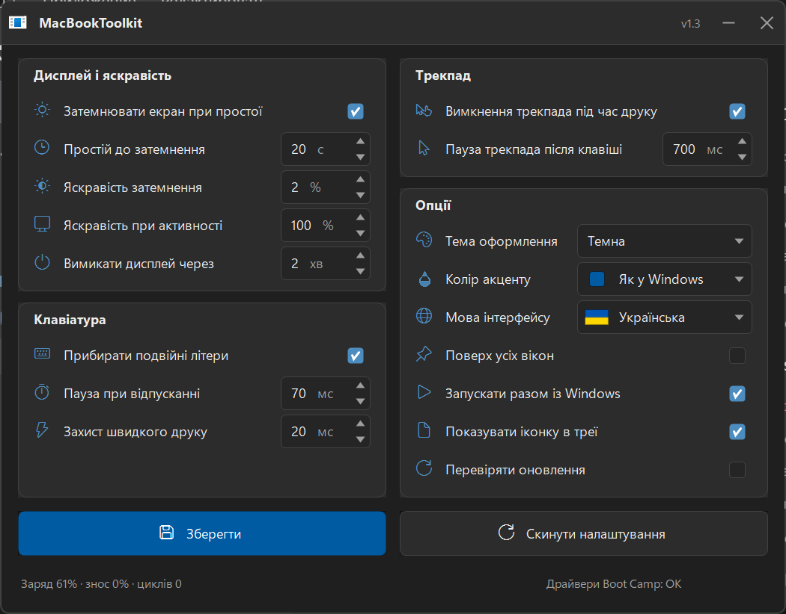

# 🖥️ MacBookToolkit

**[🇬🇧 English](#english)** · **[🇷🇺 Русский](#russian)** · **[🇺🇦 Українська](#ukrainian)**

> A tiny, portable **Windows utility made for MacBook hardware** running Windows natively (Boot Camp).
> It restores the small quality-of-life things Windows lacks on a Mac: adaptive screen dimming,
> palm rejection for the trackpad, key-chatter protection for the butterfly keyboard, a themed tray menu,
> battery health, updates and a compact Windows 11 style UI in **English, Russian and Ukrainian**.

**📥 [Download the latest release](https://github.com/the-big-paul/MacBookToolkit/releases/latest)** · **📄 [MIT License](LICENSE)** · **🧪 328 automated tests**


## 📸 Screenshots

| Language | Light | Dark |
|---|---|---|
| 🇬🇧 English |  |  |
| 🇷🇺 Русский |  |  |
| 🇺🇦 Українська |  |  |

---

<a id="english"></a>
## 🇬🇧 English

### What it is

**MacBookToolkit** is a single portable `.exe` for Windows running on MacBook hardware (Boot Camp).
No installer, no admin rights, no background services. It was born because Windows on a MacBook
misses a few things macOS users take for granted.

### Features

**🖥️ Display & brightness**
- **Dim the screen when idle** — after a chosen number of seconds without input the brightness drops
  to a chosen level; any key or touch instantly restores normal brightness.
- **Active brightness**, **dimming level** and **display timeout** are adjustable.
- The **section titles are clickable**: “Display” opens Windows power/sleep settings, “brightness” opens
  Windows display settings.

**⌨️ Keyboard**
- **Remove double-typed letters** — chatter suppression for the butterfly keyboard.
- **Pause on key release** — a same-key press arriving too soon after release is treated as chatter.
- **Fast-typing protection** — a second press without release arriving too fast is dropped.
- Timeouts are **auto-tuned**: when too many presses are dropped, the tool gently reduces the timeouts.

**🖱️ Trackpad**
- **Disable trackpad while typing** — the cursor does not jump while you type.
- **Pause after keypress** — optionally ignore touches for a short time after a key.

**⚙️ Options**
- **Theme**: follow Windows, light or dark — switched live, including the tray menu.
- **Accent colour**: 10 colours or the Windows accent.
- **Interface language**: English, Russian, Ukrainian (with flags).
- **Always on top**, **start with Windows**, **tray icon**, **check for updates**.

**🖱️ Tray menu** (right-click the icon)
Open window · Always on top · Start with Windows · **Do not dim for 10 minutes** ·
**Lock keyboard** · Lock PC · Sleep · Hibernate · Battery status · **Check for updates** · Exit.

**⌨️ Global hotkeys** (`Ctrl+Alt`)

| Hotkey | Action |
|---|---|
| `Ctrl+Alt+D` | toggle screen dimming |
| `Ctrl+Alt+T` | toggle trackpad protection |
| `Ctrl+Alt+P` | toggle always-on-top |
| `Ctrl+Alt+K` | lock / unlock the keyboard |

**ℹ️ Bottom info line** — battery charge / wear / cycle count and Boot Camp driver status.
Clickable section titles open the matching Windows Settings pages.

**✨ UX details** — Segoe Fluent Icons, custom themed tooltips with practical recommendations,
compact 700×548 layout, system font, single instance, DPI aware, no clipping in RU/UK/EN.

### Requirements

- Windows 10 or Windows 11 (x64), .NET Framework 4.8 (included in Windows).
- **Boot Camp drivers** for the MacBook hardware features (brightness, trackpad, keyboard).
- No administrator rights required; settings are stored in `%APPDATA%\MacBookToolkit`.

### Tested on

MacBook Pro (Boot Camp), Windows 11 26H2 build 26300, 150 % scaling, 1920×1200.

### Build and test

```powershell
powershell -ExecutionPolicy Bypass -File build.ps1
powershell -ExecutionPolicy Bypass -File tests\run-tests.ps1
```

The project is compiled with the built-in .NET Framework compiler (`csc.exe`); no SDK or NuGet needed.
`tests/run-tests.ps1` runs **328** logic tests.

### How it works (short)

Low-level keyboard/mouse hooks with a small debounce state machine, WMI brightness control,
`powercfg` for display timeout, registry for theme/accent and autostart, WinForms owner-drawn
controls for the Windows 11 look, and a lightweight GitHub release checker.

### Changelog

#### 1.3.0 — 2026-11-14
- Full redesign: 4 sections, aligned grid, compact 700×548 layout, single info line under the buttons.
- Segoe Fluent Icons everywhere; original Mt icon kept, no glyph duplication.
- Light / dark / system theme, 10 accent colours, themed tray menu.
- Custom tooltips: hover only over content, readable balloon, practical recommendations.
- Localised units, labels, tooltips and menu in RU / UK / EN; system font.
- Trackpad and keyboard protections with automatic timeout tuning.
- Global hotkeys, tray quick actions (no-dim, keyboard lock, lock/sleep/hibernate).
- Battery health (charge / wear / cycles) and Boot Camp driver status.
- Update checker and download of a new `.exe`; section titles open Windows Settings.
- Removed the CPU temperature option: Boot Camp Windows does not expose a thermal sensor.

#### 1.2.0
- Windows light/dark theme and accent colour, always-on-top, tray single-click and menu,
  compact DPI-aware layout, startup recalibration, single-instance activation.

### License

MIT — see [LICENSE](LICENSE).

### Disclaimer

Not affiliated with Apple. “MacBook” and “Boot Camp” are trademarks of Apple Inc.
Use at your own risk.

---

<a id="russian"></a>
## 🇷🇺 Русский

### Что это

**MacBookToolkit** — один портативный `.exe` для Windows на MacBook (Boot Camp).
Без установки, без прав администратора, без фоновых служб. Программа возвращает то,
чего не хватает Windows на MacBook.

### Возможности

**🖥️ Дисплей и яркость**
- **Затемнять экран при простое** — через заданное время бездействия яркость снижается
  до выбранного уровня; любое действие мгновенно возвращает обычную яркость.
- Настраиваются **яркость при активности**, **яркость затемнения** и **таймаут дисплея**.
- **Заголовки разделов кликабельны**: «Дисплей» открывает параметры питания/сна Windows,
  «яркость» — параметры дисплея.

**⌨️ Клавиатура**
- **Убирать двойные буквы** — подавление дребезга «бабочки».
- **Пауза при отпускании** — повторное нажатие слишком быстро после отпускания считается дребезгом.
- **Защита быстрой печати** — второе нажатие без отпускания, пришедшее слишком быстро, отбрасывается.
- Таймауты **авто-корректируются**, если программа замечает слишком много отброшенных нажатий.

**🖱️ Трекпад**
- **Отключение трекпада при печати** — курсор не прыгает во время набора.
- **Пауза трекпада после клавиши** — короткое игнорирование касаний после нажатия.

**⚙️ Опции**
- **Тема**: как в Windows, светлая, тёмная — переключается на лету, включая меню трея.
- **Цвет акцента**: 10 цветов или системный.
- **Язык интерфейса**: русский, украинский, английский (с флагами).
- **Поверх всех окон**, **запускать с Windows**, **иконка в трее**, **проверять обновления**.

**🖱️ Меню в трее** (правый клик)
Открыть окно · Поверх всех окон · Запускать с Windows · **Не затемнять 10 минут** ·
**Блокировать клавиатуру** · Заблокировать компьютер · Спящий режим · Гибернация ·
Статус батареи · **Проверить обновления** · Выход.

**⌨️ Глобальные горячие клавиши** (`Ctrl+Alt`)

| Клавиши | Действие |
|---|---|
| `Ctrl+Alt+D` | включить/выключить затемнение |
| `Ctrl+Alt+T` | включить/выключить защиту трекпада |
| `Ctrl+Alt+P` | поверх всех окон |
| `Ctrl+Alt+K` | блокировка/разблокировка клавиатуры |

**ℹ️ Информационная строка снизу** — заряд/износ/циклы батареи и состояние драйверов Boot Camp.
Кликабельные заголовки разделов открывают нужные страницы параметров Windows.

**✨ Детали UX** — иконки Segoe Fluent, собственные подсказки с рекомендациями, компактный
макет 700×548, системный шрифт, один экземпляр, поддержка DPI, без обрезаний в RU/UK/EN.

### Требования

- Windows 10/11 (x64), .NET Framework 4.8.
- **Драйверы Boot Camp** для функций железа (яркость, трекпад, клавиатура).
- Права администратора не нужны; настройки в `%APPDATA%\MacBookToolkit`.

### Проверено на

MacBook Pro (Boot Camp), Windows 11 26H2 build 26300, масштаб 150 %, 1920×1200.

### Сборка и тесты

```powershell
powershell -ExecutionPolicy Bypass -File build.ps1
powershell -ExecutionPolicy Bypass -File tests\run-tests.ps1
```

Компиляция встроенным компилятором .NET Framework (`csc.exe`), без SDK и NuGet.
Тестовый набор: **328** проверок.

### Как это устроено (кратко)

Низкоуровневые хуки клавиатуры/мыши и небольшой debounce-конечный автомат, управление яркостью
через WMI, `powercfg` для таймаута дисплея, реестр для темы/акцента и автозапуска,
собственные отрисовываемые элементы WinForms и лёгкая проверка релизов GitHub.

### Changelog

#### 1.3.0 — 2026-11-14
- Полный редизайн: 4 раздела, выровненная сетка, компактный макет 700×548, одна инфострока под кнопками.
- Иконки Segoe Fluent; исходная иконка Mt сохранена, без дублей.
- Светлая/тёмная/системная тема, 10 цветов акцента, меню трея в теме.
- Собственные подсказки: только над содержимым, читаемый balloon, практические рекомендации.
- Локализованы единицы, подписи, подсказки и меню RU/UK/EN; системный шрифт.
- Защита трекпада и клавиатуры с авто-настройкой таймаутов.
- Глобальные горячие клавиши, быстрые действия в трее (не затемнять, блокировка клавиатуры, сон/гибернация).
- Здоровье батареи (заряд/износ/циклы) и статус драйверов Boot Camp.
- Проверка и скачивание обновлений; заголовки разделов открывают параметры Windows.
- Убрана температура CPU: Boot Camp Windows не отдаёт температурный датчик.

#### 1.2.0
- Светлая/тёмная тема Windows и акцент, поверх всех окон, трей, компактный DPI-макет,
  калибровка при старте, активация одного экземпляра.

### Лицензия

MIT — см. [LICENSE](LICENSE).

### Отказ от ответственности

Не связан с Apple. «MacBook» и «Boot Camp» — товарные знаки Apple Inc. Используйте на свой риск.

---

<a id="ukrainian"></a>
## 🇺🇦 Українська

### Що це

**MacBookToolkit** — один портативний `.exe` для Windows на MacBook (Boot Camp).
Без встановлення, без прав адміністратора, без фонових служб. Програма повертає те,
чого бракує Windows на MacBook.

### Можливості

**🖥️ Дисплей і яскравість**
- **Затемнювати екран при простої** — після заданого часу бездіяльності яскравість знижується
  до вибраного рівня; будь-яка дія одразу повертає звичайну яскравість.
- Налаштовуються **яскравість при активності**, **яскравість затемнення** і **тайм-аут дисплея**.
- **Заголовки розділів клікабельні**: «Дисплей» відкриває параметри живлення/сну Windows,
  «яскравість» — параметри дисплея.

**⌨️ Клавіатура**
- **Прибирати подвійні літери** — придушення брязкоту «метелика».
- **Пауза при відпусканні** — повторне натискання надто швидко після відпускання вважається брязкотом.
- **Захист швидкого друку** — друге натискання без відпускання, що прийшло надто швидко, відкидається.
- Тайм-аути **авто-коригуються**, якщо програма бачить забагато відкинутих натискань.

**🖱️ Трекпад**
- **Вимкнення трекпада під час друку** — курсор не стрибає під час набору.
- **Пауза трекпада після клавіші** — коротке ігнорування торкань після натискання.

**⚙️ Опції**
- **Тема**: як у Windows, світла, темна — перемикається на льоту, включно з меню в треї.
- **Колір акценту**: 10 кольорів або системний.
- **Мова інтерфейсу**: українська, російська, англійська (з прапорами).
- **Поверх усіх вікон**, **запускати разом із Windows**, **іконка в треї**, **перевіряти оновлення**.

**🖱️ Меню в треї** (правий клік)
Відкрити вікно · Поверх усіх вікон · Запускати разом із Windows · **Не затемнювати 10 хвилин** ·
**Блокувати клавіатуру** · Заблокувати комп'ютер · Сплячий режим · Гібернація ·
Стан батареї · **Перевірити оновлення** · Вихід.

**⌨️ Глобальні гарячі клавіші** (`Ctrl+Alt`)

| Клавіші | Дія |
|---|---|
| `Ctrl+Alt+D` | увімкнути/вимкнути затемнення |
| `Ctrl+Alt+T` | увімкнути/вимкнути захист трекпада |
| `Ctrl+Alt+P` | поверх усіх вікон |
| `Ctrl+Alt+K` | блокування/розблокування клавіатури |

**ℹ️ Інформаційний рядок знизу** — заряд/знос/цикли батареї та стан драйверів Boot Camp.
Клікабельні заголовки розділів відкривають потрібні сторінки параметрів Windows.

**✨ Деталі UX** — іконки Segoe Fluent, власні підказки з рекомендаціями, компактний
макет 700×548, системний шрифт, один екземпляр, підтримка DPI, без обрізань у RU/UK/EN.

### Вимоги

- Windows 10/11 (x64), .NET Framework 4.8.
- **Драйвери Boot Camp** для функцій заліза (яскравість, трекпад, клавіатура).
- Права адміністратора не потрібні; налаштування в `%APPDATA%\MacBookToolkit`.

### Перевірено на

MacBook Pro (Boot Camp), Windows 11 26H2 build 26300, масштаб 150 %, 1920×1200.

### Збірка та тести

```powershell
powershell -ExecutionPolicy Bypass -File build.ps1
powershell -ExecutionPolicy Bypass -File tests\run-tests.ps1
```

Компіляція вбудованим компілятором .NET Framework (`csc.exe`), без SDK і NuGet.
Набір тестів: **328** перевірок.

### Як це влаштовано (коротко)

Низькорівневі хуки клавіатури/миші та невеликий debounce-автомат, керування яскравістю
через WMI, `powercfg` для тайм-ауту дисплея, реєстр для теми/акценту й автозапуску,
власні елементи WinForms і легка перевірка релізів GitHub.

### Changelog

#### 1.3.0 — 2026-11-14
- Повний редизайн: 4 розділи, вирівняна сітка, компактний макет 700×548, один інформаційний рядок під кнопками.
- Іконки Segoe Fluent; початкова іконка Mt збережена, без дублів.
- Світла/темна/системна тема, 10 кольорів акценту, меню в треї за темою.
- Власні підказки: лише над вмістом, читабельний balloon, практичні рекомендації.
- Локалізовано одиниці, підписи, підказки та меню RU/UK/EN; системний шрифт.
- Захист трекпада й клавіатури з авто-налаштуванням тайм-аутів.
- Глобальні гарячі клавіші, швидкі дії в треї (не затемнювати, блокування клавіатури, сон/гібернація).
- Стан батареї (заряд/знос/цикли) і статус драйверів Boot Camp.
- Перевірка й завантаження оновлень; заголовки розділів відкривають параметри Windows.
- Прибрано температуру CPU: Boot Camp Windows не надає температурний датчик.

#### 1.2.0
- Світла/темна тема Windows і акцент, поверх усіх вікон, трей, компактний DPI-макет,
  калібрування під час старту, активація одного екземпляра.

### Ліцензія

MIT — див. [LICENSE](LICENSE).

### Відмова від відповідальності

Не пов'язаний з Apple. «MacBook» і «Boot Camp» — торгові марки Apple Inc. Використовуйте на свій ризик.
