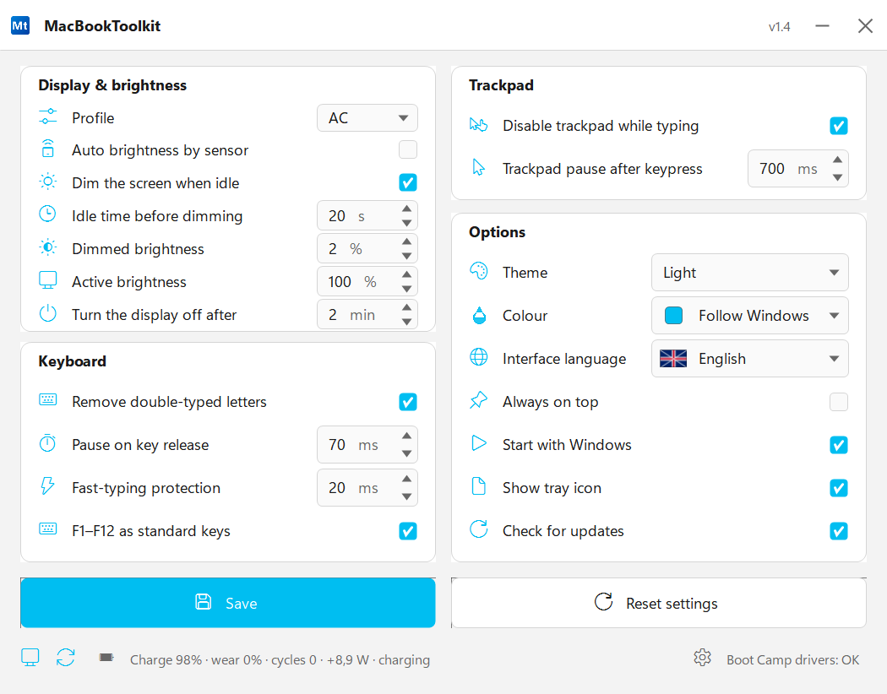
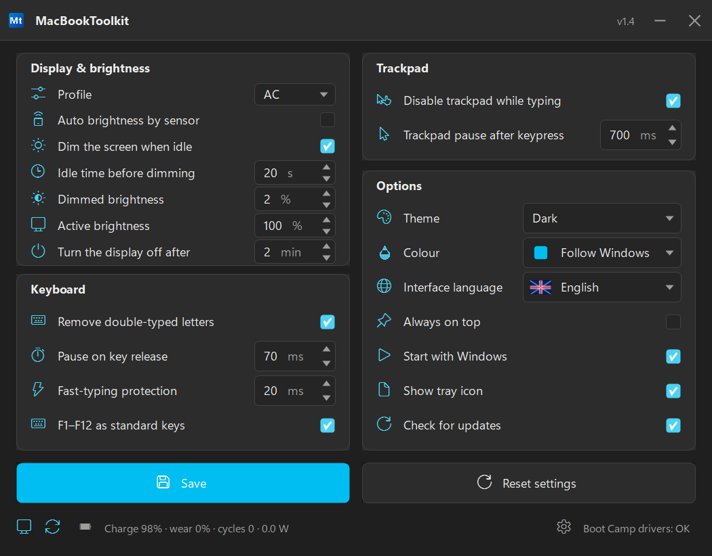
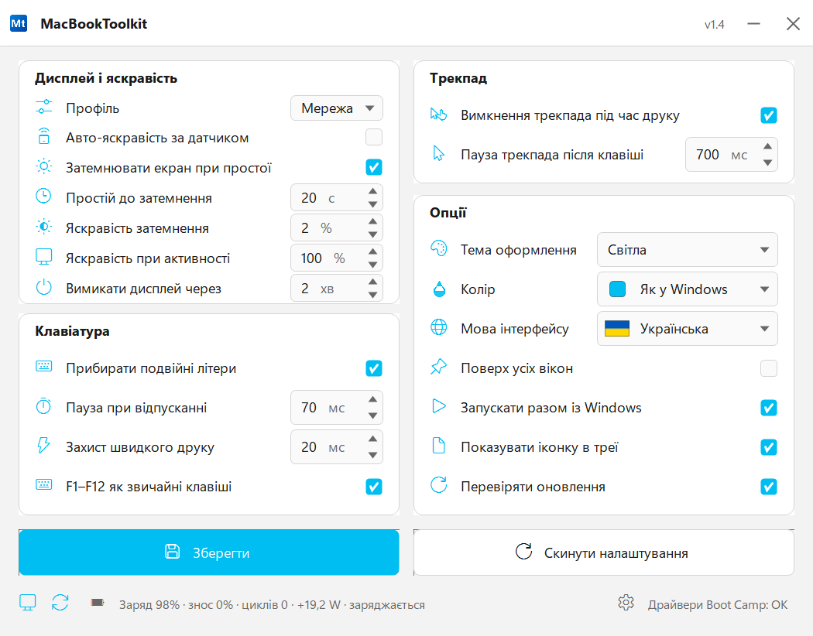
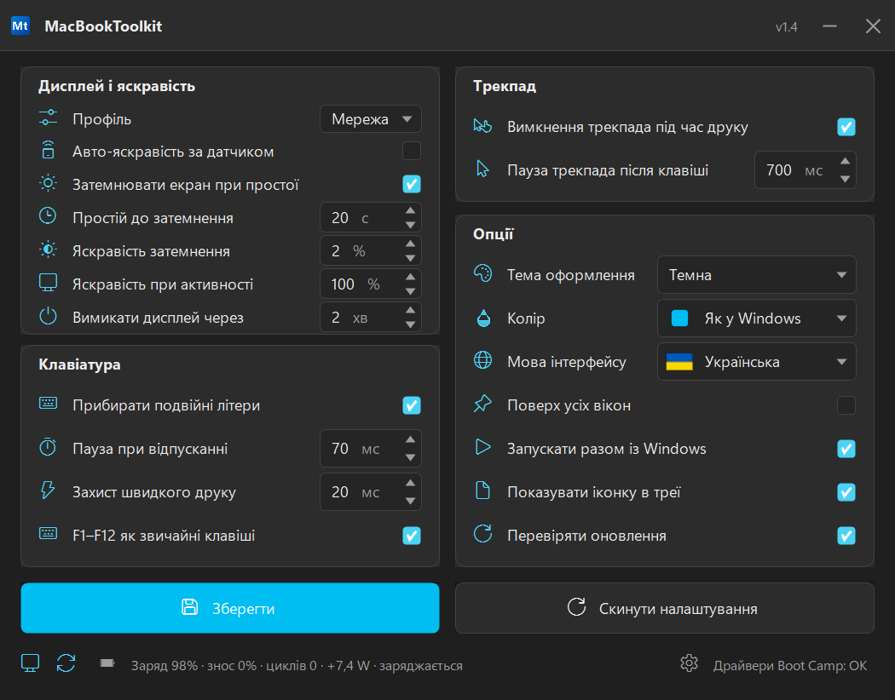

# 🖥️ MacBookToolkit

**[🇷🇺 Русский](#русский)** · **[🇬🇧 English](#english)** · **[🇺🇦 Українська](#українська)**

> **Версия 1.4** — компактная портативная утилита для Windows на MacBook (Boot Camp):
> профили «Сеть/Батарея», авто-яркость по датчику, Fn/F1–F12, затемнение экрана,
> защита трекпада и клавиатуры, батарея с ваттами и статус Boot Camp.
>
> **Version 1.4** — a tiny portable Windows utility for MacBook hardware (Boot Camp):
> AC/battery profiles, ambient-light auto brightness, Fn/F1–F12, screen dimming,
> trackpad and keyboard protection, battery with watts and Boot Camp status.
>
> **Версія 1.4** — компактна портативна утиліта для Windows на MacBook (Boot Camp):
> профілі «Мережа/Батарея», авто-яскравість за датчиком, Fn/F1–F12, затемнення екрана,
> захист трекпада й клавіатури, батарея з ватами та статус Boot Camp.

**📥 [Скачать последнюю версию](https://github.com/the-big-paul/MacBookToolkit/releases/latest)** · **📄 [MIT License](LICENSE)** · **🧪 339 автоматических тестов**

## 📸 Скриншоты

| Язык | Светлая тема | Тёмная тема |
|---|---|---|
| 🇷🇺 Русский |  |  |
| 🇬🇧 English |  |  |
| 🇺🇦 Українська |  |  |

---

## 🇷🇺 Русский

**Версия: 1.4**

### Что это

MacBookToolkit — один портативный .exe для Windows на MacBook (Boot Camp).
Без установщика, без прав администратора, без фоновых служб и без драйверов.
Утилита возвращает то, чего не хватает Windows на MacBook.

### Возможности

**🖥️ Дисплей и яркость**
- Профили «Сеть/Батарея» — первая строка раздела. Для каждого профиля отдельно
  настраиваются простой, затемнение, яркость при активности и таймаут дисплея;
  переключение автоматическое по источнику питания.
- Авто-яркость по датчику освещённости (ALS).
- Затемнение экрана при простое; любое нажатие возвращает нормальную яркость.
- Яркость при активности, уровень затемнения и таймаут дисплея настраиваются.
- Заголовки разделов кликабельны и открывают нужные настройки Windows.

**⌨️ Клавиатура**
- Убирать двойные буквы — подавление дребезга butterfly-клавиатуры.
- Пауза при отпускании и защита быстрой печати; таймауты автотюнятся.
- F1–F12 как обычные клавиши — переключение поведения верхнего ряда Boot Camp,
  включая Touch Bar/DFR; состояние читается из OSXFnBehavior и применяется через IOCTL.

**🖱️ Трекпад**
- Отключение трекпада при печати.
- Пауза после нажатия клавиши.

**⚙️ Опции**
- Тема: как в Windows, светлая или тёмная; меню трея следует теме.
- Цвет акцента: 10 цветов или акцент Windows.
- Язык интерфейса: русский, английский, украинский.
- Поверх всех окон, запуск с Windows, иконка в трее, проверка обновлений.

**📊 Строка статуса**
- Заряд, износ, циклы, ток в ваттах и оставшееся время/«заряжается».
- Статус драйверов Boot Camp.
- Иконки Boot Camp Control Panel и Apple Software Update — открываются по клику.

**🖱️ Меню трея** (правый клик)
Открыть окно · Поверх всех окон · Запускать с Windows · Не затемнять 10 минут ·
Блокировать клавиатуру · Заблокировать ПК · Сон · Гибернация · Батарея ·
Проверить обновления · Настройки трекпада · Выход.

**⌨️ Глобальные горячие клавиши (Ctrl+Alt)**

| Комбинация | Действие |
|---|---|
| Ctrl+Alt+D | включить/выключить затемнение экрана |
| Ctrl+Alt+T | включить/выключить защиту трекпада |
| Ctrl+Alt+P | включить/выключить «поверх всех окон» |
| Ctrl+Alt+K | заблокировать/разблокировать клавиатуру |

**✨ Детали**
Segoe Fluent Icons, тематические подсказки, компактный макет 700×548,
системный шрифт, один экземпляр, DPI awareness, без обрезки текста в RU/UK/EN.

### Требования

- Windows 10 или Windows 11 (x64), .NET Framework 4.8.
- Драйверы Boot Camp для функций железа.
- Права администратора не нужны; настройки в %APPDATA%/MacBookToolkit.

### Проверено на

MacBook Pro (Boot Camp), Windows 11 26H2 build 26300, масштаб 150 %, 1920×1200.

### Сборка и тесты

    powershell -ExecutionPolicy Bypass -File build.ps1
    powershell -ExecutionPolicy Bypass -File tests/run-tests.ps1

Сборка встроенным компилятором .NET Framework (csc.exe); SDK и NuGet не нужны.
Тестов: 339, UI-аудит: 61.

### Как это устроено

Хуки клавиатуры/мыши с автоматом подавления дребезга, WMI-яркость, powercfg,
реестр для темы/автозапуска, owner-drawn WinForms, проверка релизов GitHub,
WinRT-датчик освещённости для авто-яркости.

### Changelog

#### 1.4.0 — 2026-11-14
- Профили «Сеть/Батарея» отдельной первой строкой.
- Авто-яркость по ALS.
- Fn/F1–F12 в разделе «Клавиатура», включая Touch Bar/DFR.
- Батарея: ватты, время/«заряжается», уведомления.
- Иконки Boot Camp Control Panel и Apple Software Update в статусе.
- Определение Precision Touchpad. 339 тестов, 61 UI-проверка.

#### 1.3.1 — 2026-11-14
- Исправлена проверка обновлений; трёхъязычные описания и скриншоты.

#### 1.3.0 — 2026-11-14
- Новый интерфейс Windows 11: 4 раздела, иконки, темы, трей, горячие клавиши.

### Лицензия

MIT.

### Отказ от ответственности

Утилита управляет яркостью, таймаутами, хуками ввода и настройками Boot Camp.
Используйте на свой риск; автор не отвечает за последствия.

---

## 🇬🇧 English

**Version: 1.4**

### What it is

MacBookToolkit is a single portable .exe for Windows on MacBook hardware (Boot Camp).
No installer, no admin rights, no background services and no drivers.
It restores the small quality-of-life things Windows lacks on a Mac.

### Features

**🖥️ Display & brightness**
- AC/battery profiles — the first row of the section. Idle, dimming, active brightness
  and display timeout are configured per profile; switching is automatic by power source.
- Ambient-light auto brightness (ALS).
- Dim the screen when idle; any key or touch restores normal brightness.
- Active brightness, dimming level and display timeout are adjustable.
- Section titles are clickable and open the matching Windows settings.

**⌨️ Keyboard**
- Remove double-typed letters — chatter suppression for the butterfly keyboard.
- Pause on key release and fast-typing protection; timeouts are auto-tuned.
- F1–F12 as standard keys — switches the Boot Camp top-row behaviour, including
  Touch Bar/DFR; the state is read from OSXFnBehavior and applied via IOCTL.

**🖱️ Trackpad**
- Disable trackpad while typing.
- Pause after keypress.

**⚙️ Options**
- Theme: follow Windows, light or dark; the tray menu follows the theme.
- Accent colour: 10 colours or the Windows accent.
- Interface language: Russian, English, Ukrainian.
- Always on top, start with Windows, tray icon, check for updates.

**📊 Status line**
- Charge, wear, cycles, watts and time left / charging.
- Boot Camp driver status.
- Boot Camp Control Panel and Apple Software Update icons — click to open.

**🖱️ Tray menu** (right-click)
Open window · Always on top · Start with Windows · Do not dim for 10 minutes ·
Lock keyboard · Lock PC · Sleep · Hibernate · Battery status ·
Check for updates · Touchpad settings · Exit.

**⌨️ Global hotkeys (Ctrl+Alt)**

| Hotkey | Action |
|---|---|
| Ctrl+Alt+D | toggle screen dimming |
| Ctrl+Alt+T | toggle trackpad protection |
| Ctrl+Alt+P | toggle always-on-top |
| Ctrl+Alt+K | lock / unlock the keyboard |

**✨ UX details**
Segoe Fluent Icons, themed tooltips, compact 700×548 layout,
system font, single instance, DPI aware, no clipping in RU/UK/EN.

### Requirements

- Windows 10 or Windows 11 (x64), .NET Framework 4.8.
- Boot Camp drivers for the hardware features.
- No administrator rights required; settings in %APPDATA%/MacBookToolkit.

### Tested on

MacBook Pro (Boot Camp), Windows 11 26H2 build 26300, 150 % scaling, 1920×1200.

### Build and test

    powershell -ExecutionPolicy Bypass -File build.ps1
    powershell -ExecutionPolicy Bypass -File tests/run-tests.ps1

Compiled with the built-in .NET Framework compiler (csc.exe); no SDK or NuGet needed.
339 logic tests, 61 UI audit checks.

### How it works

Keyboard/mouse hooks with a debounce state machine, WMI brightness, powercfg,
registry for theme/autostart, owner-drawn WinForms, GitHub release check,
WinRT ambient-light sensor for auto brightness.

### Changelog

#### 1.4.0 — 2026-11-14
- AC/battery profiles as a separate first row.
- Ambient-light auto brightness (ALS).
- Fn/F1–F12 in the Keyboard section, including Touch Bar/DFR.
- Battery: watts, time/charging, notifications.
- Boot Camp Control Panel and Apple Software Update icons in the status line.
- Precision Touchpad detection. 339 tests, 61 UI checks.

#### 1.3.1 — 2026-11-14
- Fixed the update checker; trilingual descriptions and screenshots.

#### 1.3.0 — 2026-11-14
- New Windows 11 UI: 4 sections, icons, themes, tray, hotkeys.

### License

MIT.

### Disclaimer

The utility controls brightness, timeouts, input hooks and Boot Camp settings.
Use at your own risk; the author is not responsible for any consequences.

---

## 🇺🇦 Українська

**Версія: 1.4**

### Що це

MacBookToolkit — один портативний .exe для Windows на MacBook (Boot Camp).
Без інсталятора, без прав адміністратора, без фонових служб і без драйверів.
Утиліта повертає те, чого бракує Windows на MacBook.

### Можливості

**🖥️ Дисплей і яскравість**
- Профілі «Мережа/Батарея» — перший рядок розділу. Для кожного профілю окремо
  налаштовуються простій, затемнення, яскравість при активності й тайм-аут дисплея;
  перемикання автоматичне за джерелом живлення.
- Авто-яскравість за датчиком освітленості (ALS).
- Затемнення екрана при простої; будь-яке натискання повертає нормальну яскравість.
- Яскравість при активності, рівень затемнення й тайм-аут дисплея налаштовуються.
- Заголовки розділів клікабельні й відкривають потрібні налаштування Windows.

**⌨️ Клавіатура**
- Прибирати подвійні літери — придушення брязкоту butterfly-клавіатури.
- Пауза після відпускання й захист швидкого друку; тайм-аути автонастроюються.
- F1–F12 як звичайні клавіші — перемикання поведінки верхнього ряду Boot Camp,
  включно з Touch Bar/DFR; стан читається з OSXFnBehavior і застосовується через IOCTL.

**🖱️ Трекпад**
- Вимкнення трекпада під час друку.
- Пауза після натискання клавіші.

**⚙️ Опції**
- Тема: як у Windows, світла або темна; меню в треї за темою.
- Колір акценту: 10 кольорів або акцент Windows.
- Мова інтерфейсу: українська, російська, англійська.
- Поверх усіх вікон, запуск із Windows, іконка в треї, перевірка оновлень.

**📊 Рядок статусу**
- Заряд, знос, цикли, струм у ватах і залишок часу/«заряджається».
- Статус драйверів Boot Camp.
- Іконки Boot Camp Control Panel і Apple Software Update — відкриваються кліком.

**🖱️ Меню в треї** (правий клік)
Відкрити вікно · Поверх усіх вікон · Запускати з Windows · Не затемнювати 10 хвилин ·
Блокувати клавіатуру · Заблокувати ПК · Сон · Гібернація · Батарея ·
Перевірити оновлення · Налаштування трекпада · Вихід.

**⌨️ Глобальні гарячі клавіші (Ctrl+Alt)**

| Комбінація | Дія |
|---|---|
| Ctrl+Alt+D | увімкнути/вимкнути затемнення екрана |
| Ctrl+Alt+T | увімкнути/вимкнути захист трекпада |
| Ctrl+Alt+P | увімкнути/вимкнути «поверх усіх вікон» |
| Ctrl+Alt+K | заблокувати/розблокувати клавіатуру |

**✨ Деталі**
Segoe Fluent Icons, тематичні підказки, компактний макет 700×548,
системний шрифт, один екземпляр, DPI awareness, без обрізання тексту в RU/UK/EN.

### Вимоги

- Windows 10 або Windows 11 (x64), .NET Framework 4.8.
- Драйвери Boot Camp для функцій заліза.
- Права адміністратора не потрібні; налаштування в %APPDATA%/MacBookToolkit.

### Перевірено на

MacBook Pro (Boot Camp), Windows 11 26H2 build 26300, масштаб 150 %, 1920×1200.

### Збірка та тести

    powershell -ExecutionPolicy Bypass -File build.ps1
    powershell -ExecutionPolicy Bypass -File tests/run-tests.ps1

Збірка вбудованим компілятором .NET Framework (csc.exe); SDK і NuGet не потрібні.
Тестів: 339, UI-аудит: 61.

### Як це влаштовано

Хуки клавіатури/миші з автоматом придушення брязкоту, WMI-яскравість, powercfg,
реєстр для теми/автозапуску, owner-drawn WinForms, перевірка релізів GitHub,
WinRT-датчик освітленості для авто-яскравості.

### Changelog

#### 1.4.0 — 2026-11-14
- Профілі «Мережа/Батарея» окремим першим рядком.
- Авто-яскравість за ALS.
- Fn/F1–F12 у розділі «Клавіатура», включно з Touch Bar/DFR.
- Батарея: вати, час/«заряджається», сповіщення.
- Іконки Boot Camp Control Panel і Apple Software Update у статусі.
- Визначення Precision Touchpad. 339 тестів, 61 UI-перевірка.

#### 1.3.1 — 2026-11-14
- Виправлено перевірку оновлень; трьохмовні описи й скриншоти.

#### 1.3.0 — 2026-11-14
- Новий інтерфейс Windows 11: 4 розділи, іконки, теми, трей, гарячі клавіші.

### Ліцензія

MIT.

### Відмова від відповідальності

Утиліта керує яскравістю, тайм-аутами, хуками введення й налаштуваннями Boot Camp.
Використовуйте на свій ризик; автор не відповідає за наслідки.
